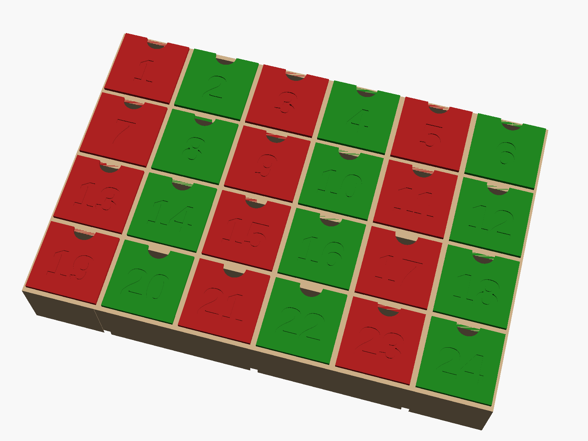

# Refillable 3D-printed advent calendar

24 pull-out drawers in a wall-hangable frame. Fill the drawers, hang it up, and
refill it again next year. Every part prints without supports and fits a
220 × 220 mm bed.



## What's in this folder

| File | What it is |
| --- | --- |
| `advent_calendar.scad` | The parametric model. Open in [OpenSCAD](https://openscad.org) to change sizes. |
| `export.sh` | Rebuilds every STL and the preview from the model. |
| `stl/frame_module.stl` | One 2 × 2 frame block. |
| `stl/drawer_01.stl` … `drawer_24.stl` | The numbered drawers. |
| `stl/key.stl` | Dovetail key that locks two frame blocks together. |
| `stl/hanger.stl` | Wall hanger tab that slides into the top of the frame. |

## Sizes (defaults)

| | Size |
| --- | --- |
| Space inside each drawer | 50 W × 52 H × 50 D mm |
| Drawer front | 56.5 × 56.5 mm |
| Frame block | 122 × 122 × 54 mm |
| Whole calendar | 366 W × 244 H × 57 D mm (plus hanger tabs above) |

## Parts list

| Part | Quantity |
| --- | --- |
| Frame module | 6 |
| Drawer | 24 (one of each number) |
| Key | 7, plus 1 spare |
| Hanger | 3 (one per top block; 2 is enough on a sturdy screw) |

Rough filament use is about 1.4 kg of PLA at the settings below. Your slicer
will give the exact figure.

## Print settings

These work for PLA or PETG on any common printer with a 0.4 mm nozzle.

| Setting | Value |
| --- | --- |
| Layer height | 0.2 mm |
| Walls / perimeters | 3 |
| Top and bottom layers | 4 |
| Infill | 15 % gyroid or grid |
| Supports | Off |
| Brim | Optional, 5 mm, on frame modules if your bed adhesion is weak |

### Orientation

The STLs are already in print orientation, so just drop them on the plate.

- **Frame modules** print on their back, with the four openings facing up.
- **Drawers** print standing on their bottom, open top up. The number faces
  sideways, so it comes out crisp. About four fit on one plate.
- **Keys** print lying flat.
- **Hangers** print with the flat tab on the bed and the fin pointing up.

### Two-colour numbers (optional)

The numbers are recessed 1 mm by default. Set `number_depth = -0.8` in the
model to make them raised instead; raised numbers are easy to colour with a
paint pen.

An easier look is to alternate drawer colours (red and green, for example) like
the preview shows.

## Assembly

1. Test-fit one drawer in one module. It should slide freely and click shut
   when pushed in. If it's tight, see Troubleshooting.
2. Lay the six modules face-down on a table in 3 columns × 2 rows, so their
   backs face you.
3. Slide a key into each seam from the back: 4 keys in the vertical seams and
   3 in the horizontal seams. Each key stops a couple of millimetres short of
   the front, so it won't show. A tap with a rubber mallet helps.
4. Slide a hanger into the slot on top of each top-row module, again from the
   back, so its tab stands up above the frame flush with the back.
5. Stand the calendar up, fill the drawers and slot them in. Any drawer fits
   any opening.
6. Hang it from screws or nails through the hanger holes (4.5 mm). The calendar
   weighs roughly 1.5 kg empty, so use wall plugs in plasterboard.

A drop of glue in the key slots makes the frame permanent, but it isn't
needed and leaving it unglued lets the calendar pack flat after December.

### Mixed-up order

Drawers are interchangeable, so you can put them in any order. This layout
hides the numbers so the hunt is part of the fun:

```
 17   4  22   9  14   1
  8  20   3  24  11  19
 13   6  15   2  21   7
 23  10  18  12   5  16
```

## Changing the design

Open `advent_calendar.scad` in OpenSCAD and use the Customizer panel, or edit
the values at the top of the file. The ones you're most likely to change:

| Parameter | Default | What it does |
| --- | --- | --- |
| `inner_w`, `inner_h`, `inner_d` | 50, 52, 50 | Space inside each drawer. Everything else resizes to match. |
| `clearance` | 0.4 | Gap around each drawer. Raise to 0.5 if drawers stick. |
| `detent_h` | 0.5 | Height of the click-shut ridge. 0 turns it off. |
| `number_depth` | 1.0 | Recess depth of the numbers; negative makes them raised. |
| `number_font`, `number_size` | Liberation Sans Bold, 24 | Number style. |
| `panel_gap` | 4.5 | How much frame shows between drawer fronts. |

After changing anything, run `./export.sh` to rebuild all the STLs, or pick a
`part` in the Customizer and export it with F6 then F7. The console prints the
new overall size. Check that a frame module still fits your printer bed.

## Troubleshooting

- **Drawers stick:** raise `clearance` to 0.5, or check for elephant's foot on
  the bottom of the frame modules (a small chamfer or "elephant foot
  compensation" in your slicer fixes it).
- **Drawers don't click shut:** raise `detent_h` to 0.7. Don't go above
  `2 × clearance`, or the drawer can't lift over the ridge.
- **Keys too tight or loose:** adjust `key_clr` (default 0.2) and reprint only
  the keys.
